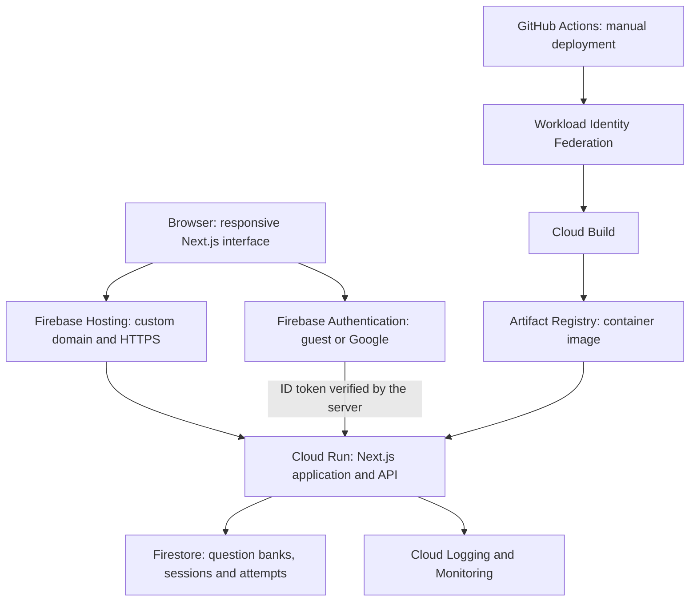

# GCP ACE Practice Lab

**A free, independent study platform for the Google Cloud Associate Cloud Engineer certification, built by [Khalid Hashim](https://khalidhashim.com).**

Practice cloud scenarios, review explanations, and track your learning progress through a responsive web application backed by Google Cloud.

**[Open the live platform](https://ace.khalidhashim.com)** · [Portfolio](https://khalidhashim.com) · [Deployment guide](docs/deployment.md)

## Study features

- **Timed mock exams:** 60-question practice forms with a 120-minute budget and randomized question order.
- **Topic practice:** focus on a specific area without the mock-exam countdown.
- **Guest access or Google sign-in:** start without creating a Google-linked account; link an eligible guest identity to Google later to retain access across devices.
- **Progress autosave:** answers, review flags, and question position are saved during an active session without pausing its timer.
- **Refresh and resume:** recover confirmed saved progress while keeping an active timed exam's original deadline.
- **Pause & save:** deliberately pause an exam and resume with its remaining time; repeated Pause requests preserve the stored budget.
- **Results and review:** inspect selections, explanations, official documentation references, topic performance, and attempt history where verified answers are available.
- **Responsive interface:** desktop and mobile layouts, light and dark themes, and a question navigator with answer and review states.
- **Protected administration:** validate and manage question-bank content through the admin editor.

### Current live catalog

The public `/api/exams` response checked on **22 October 2026** lists **six available practice exams**, each with **60 assigned questions and 120 minutes**. The two distinct question banks contain **81 and 326 questions: 407 in total**, all currently marked verified in the catalog. Shared bank totals are counted once, not once per exam. Catalog contents can change independently of application releases.

The **public repository includes the original 81-question ungraded sample bank**, not the complete production banks or private answer keys. A fresh local installation therefore has a smaller catalog than the live platform.

### Saving and guest progress

Wait for **“Progress saved”** before refreshing or leaving an exam. Pending or failed writes are not confirmed saves; the interface shows save status, provides recovery controls, and warns about leaving while changes remain pending. Autosave uses a debounce and serialized requests, with server-side progress revisions to reject stale writes. Firestore transactions protect session state transitions.

Refreshing an active timed exam does **not** pause its clock or refund elapsed time. Use **Pause & save** when you intend to pause. Expiration is enforced on the server.

Guest records are associated with a Firebase anonymous identity. Losing that browser's sign-in data, signing out, or switching devices can make guest progress inaccessible. Link Google before relying on cross-device access. Linking to an already-used Google identity does not automatically merge accounts.

## Architecture



The production application runs as `ace-prod` in `me-central1`, behind the Firebase Hosting custom domain. Cloud Run executes the application and server-side scoring; Firestore stores cloud data. Firebase Authentication identifies users, and server-side ownership checks isolate their records. The browser does not directly access Firestore through the Admin SDK.

Terraform definitions cover the cloud platform and separate development and production environments. GitHub OIDC and Workload Identity Federation provide short-lived deployment credentials without committing service account keys. Application delivery updates the existing Cloud Run service using an image digest.

## Technology stack

| Area                           | Technologies                                                              |
| ------------------------------ | ------------------------------------------------------------------------- |
| Application                    | Next.js App Router, React, TypeScript                                     |
| Interface                      | Tailwind CSS 4, semantic CSS tokens, responsive light/dark themes         |
| Identity                       | Firebase Authentication, anonymous guest identities, Google sign-in       |
| Cloud persistence              | Firestore, Firebase Admin SDK, transactional session updates              |
| Local persistence              | JSON sample bank and filesystem records                                   |
| Validation and testing         | Zod, Vitest, Playwright, Node.js cache regression tests                   |
| Runtime and delivery           | Docker, Cloud Run, Cloud Build, Artifact Registry, GitHub Actions         |
| Infrastructure and credentials | Terraform, GitHub OIDC, Workload Identity Federation                      |
| Public entry point             | Firebase Hosting and the custom HTTPS domain                              |
| Operations                     | Health endpoint, structured error logging, cloud monitoring configuration |

## Run locally

Use **Node.js 22** and npm. From the repository root:

```bash
npm ci
cp .env.example apps/web/.env.local
npm run dev
```

Open [http://localhost:3000](http://localhost:3000).

The default `DATA_MODE=local` development mode needs no Google account or cloud credentials. It uses a single development identity with admin access, the bundled sample bank, and filesystem records under `apps/web/.local/` unless `LOCAL_DATA_DIR` overrides the location. This development identity is not a production authentication mechanism.

`npm run build` can run without cloud credentials. Serving production API requests requires `DATA_MODE=firestore`; production requests deliberately reject local mode. To run the built application against cloud services, supply the appropriate Firebase configuration and Application Default Credentials or runtime service account identity.

### Environment configuration

Copy `.env.example` rather than committing credentials or `.env.local`.

| Variable               | Purpose                                                         |
| ---------------------- | --------------------------------------------------------------- |
| `DATA_MODE`            | `local` for development; `firestore` for cloud-backed operation |
| `GOOGLE_CLOUD_PROJECT` | Google Cloud/Firebase project ID in cloud mode                  |
| `FIREBASE_API_KEY`     | Firebase web application configuration                          |
| `FIREBASE_AUTH_DOMAIN` | Authorized Firebase authentication domain                       |
| `FIREBASE_APP_ID`      | Firebase web application ID                                     |
| `LOCAL_DATA_DIR`       | Optional local filesystem data directory override               |

Cloud mode additionally requires enabled authentication providers, appropriate authorized domains, and server credentials. See the [deployment guide](docs/deployment.md) for provisioning details; review those instructions for your own environment before executing commands that create resources.

## Validation

Run these checks from the repository root:

```bash
npm run validate:questions
npm run lint
npm run typecheck
npm test
npm run build
npm run test:cache
```

`validate:questions` validates the bundled 81-question sample bank. It does not inspect or publish production Firestore content.

For browser tests:

```bash
npx playwright install --with-deps chromium
npm run test:e2e
```

Playwright starts a local development server and runs desktop and mobile projects. The regression suite covers saved progress, refresh/resume behavior, timer continuity, and Pause flows. Unit/integration tests also exercise rapid edits, failed saves, stale progress revisions, and repeated/concurrent Pause requests. These local tests do not by themselves verify real Google OAuth or production IAM configuration.

## Question integrity and scoring

- The bundled source import preserves question wording and choices, with source provenance recorded in `data/source-manifest.json`. The original PDF is not redistributed here.
- The schema supports four or five choices and single or multiple selections. Published exam forms assign explicit question IDs; question order is randomized when a session starts.
- A question can contribute to scoring only when marked verified with a complete answer key, an explanation, and an allowed official documentation reference. Ungraded questions track completion without inventing a score.
- Public question payloads omit answer keys, explanations, per-option explanations, and references before submission. The server snapshots the selected questions and grades that session's version on submission.
- Keep private answer keys and production-bank input files out of this public repository. Bank-management scripts write data and are operator tools, not required local setup steps.

Verification metadata is a study-content control, not an endorsement by Google or a guarantee of certification results. Use official Google Cloud documentation alongside the practice platform.

## Deployment and caching

The existing **Approved Cloud Run deployment** workflow is manually dispatched from `main` with a `dev` or `prod` environment. It validates the application, authenticates through federation, builds a container with Cloud Build, resolves its digest, and updates the existing service. A normal README push runs validation CI; it does **not** dispatch this deployment workflow.

The application keeps HTML document responses non-cacheable while allowing hashed `/_next/static/*` assets to retain long-lived immutable caching. Production cache regression tests check document caching and static-asset behavior. Application image delivery and Firebase Hosting releases are separate operations; an application deployment does not require an unnecessary Hosting redeployment.

For release verification, check the serving Cloud Run revision and image digest, `/api/health`, the bare custom domain, referenced CSS/JavaScript assets, and an authenticated disposable user's save/resume flow. A successful build alone does not prove that production serves the intended revision.

## Repository map

| Path                            | Purpose                                                                 |
| ------------------------------- | ----------------------------------------------------------------------- |
| `apps/web/app`                  | Dashboard, exam interface, admin editor and API routes                  |
| `apps/web/lib`                  | Schemas, scoring, authentication, persistence and autosave coordination |
| `data`                          | Public sample questions and source provenance                           |
| `scripts`                       | Import validation, extraction and privileged bank/admin utilities       |
| `tests`                         | Unit, API, concurrency and production-cache regression tests            |
| `e2e`                           | Desktop and mobile browser workflows                                    |
| `infra/modules/platform`        | Reusable Google Cloud platform module                                   |
| `infra/environments/{dev,prod}` | Environment infrastructure definitions                                  |
| `infra/bootstrap`               | Terraform state bootstrap configuration                                 |
| `.github/workflows`             | Validation CI and manual application deployment                         |
| `docs`                          | Architecture, deployment, security, cost and verification notes         |

## Further documentation

- [Architecture and tradeoffs](docs/architecture.md)
- [Deployment and Firebase setup](docs/deployment.md)
- [Security model](docs/security.md)
- [Cost controls and cleanup](docs/cost.md)
- [Validation notes and known limits](docs/verification.md)

Some supporting documents describe the original bootstrap stage. Treat the current source, environment configuration, and live catalog as authoritative for current behavior; historical verification notes are not a current production audit.

## About the project

Built to make ACE preparation accessible for free and to demonstrate practical cloud engineering: full-stack development, identity and authorization, reliable session persistence, infrastructure as code, keyless CI/CD, immutable application delivery, observability, and deployment verification.

Created by **Khalid Hashim** · [Portfolio](https://khalidhashim.com) · [GitHub](https://github.com/khalidHashim1)

## License and disclaimer

Project code is MIT licensed. Study content has separate provenance and ownership; the code license does not establish redistribution rights for third-party questions. This independent learning project is not affiliated with or endorsed by Google and does not provide official certification exam questions.
